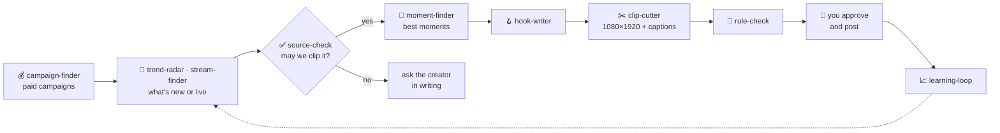

<p align="center">
  
</p>

<p align="center">
  <a href="https://github.com/codingwolf-at/cliprig/actions/workflows/test.yml"></a>
  <a href="LICENSE"></a>
  
  
  
  
</p>

<p align="center">
  <b>Turn podcasts, streams and long videos into captioned vertical clips that pay.</b><br>
  Cliprig finds paid clipping campaigns, picks the moments worth clipping, cuts 1080×1920 clips with word-by-word captions,<br>
  checks permission and campaign rules, and learns from your real numbers. You approve every post.
</p>

<p align="center">
  <a href="#see-it-work">Demo</a> ·
  <a href="#quick-start">Quick start</a> ·
  <a href="#how-it-works">How it works</a> ·
  <a href="#skills">Skills</a> ·
  <a href="#rules-it-wont-break">Rules</a> ·
  <a href="#what-leaves-your-machine">Privacy</a> ·
  <a href="#faq">FAQ</a>
</p>

---

## See it work

https://github.com/user-attachments/assets/fdca1e6d-4409-4d17-9c2c-c7a3b2ab0412

A real run, not a mock-up (the video has sound):

1. `source-check` confirmed the video is licensed CC BY and saved the proof.
2. `moment-finder` downloaded the first 10 minutes of the 86-minute episode, transcribed it on a MacBook, and ranked 6 moments using loudness, hook phrases and YouTube's "most replayed" graph.
3. `source-check` ran its music check on moment #2 and flagged one 2-second gap for a person to listen to before posting.
4. `clip-cutter` cut moment #2 into a 38-second 1080×1920 clip with the hook "He doesn't remember helping me", and `rule-check` passed it.

The video shows the same moment cut again with the current version: 34 seconds, the crop following the face in each shot, and the hook "Neal Brennan forgot he dressed Josh Johnson".

<details>
<summary><b>See the whole session</b>: from a link to "ready for your yes"</summary>

<br>

Condensed from the run above. Command output is copied as it ran; Claude's replies are shortened.

> **You:** find the moments in https://www.youtube.com/watch?v=KfnFbvwm-KQ

**Cliprig:** Permission: **PASS**. The video page shows "Creative Commons Attribution license (reuse allowed)". Proof saved to `media/raw/blocks-josh-johnson/SOURCE.md`. Scanning the first 10 minutes of the 86-minute episode:

```
signals: loudness, transcript (1933 words), most replayed
1. 0:17-0:55 (37s)  loudness spike  "Yeah. So I was like, I always felt like I was Devin's friend..."
2. 1:12-1:51 (39s)  hook words      "Remember when I was like, oh yeah, I don't know what to wear..."
3. 4:56-5:32 (36s)  overall energy  "Here's a chance to like learn about the person..."
4. 5:37-6:08 (31s)  hook words      "If I get into an Uber and I'm texting..."
5. 6:24-7:03 (38s)  hook words      "I don't know, I'd go get Quince and all my advertisements..."
6. 8:46-9:22 (36s)  hook words      "And then it was, you gave me like six months of the box..."
```

Dropped #5: it's an ad read. Best pick: **#2**. Josh remembers Neal setting him up with clothes, and Neal has no memory of it.

> **You:** cut 2

**Cliprig:** Music check on 1:10–1:53:

```
LOUD GAP 82.5s-84.4s at -15 dBFS: listen for music under it
```

The gap sits between "No. Imagine somebody." and the repeat of that line, so it's most likely laughter. Listen to 1:22–1:24 before posting. One speaker, centred, so the `fill` layout. Rule check on the cut:

```
PASS  resolution 1080x1920  [1080x1920]
PASS  fps about 30  [30.00]
PASS  has audio
PASS  duration 7-60s  [38.6s]
PASS  no banned terms in hook/caption
PASS  credit in caption
RESULT: PASS
```

Ready for your yes:

| | |
|---|---|
| File | `media/edits/kfnfbvwm-kq-aa48498c_clip2.mp4` |
| Platforms | YouTube Shorts, Instagram Reels |
| Hook | He doesn't remember helping me |
| Caption | He doesn't remember helping me. Clip from Blocks Podcast with Neal Brennan and Josh Johnson. #standup #comedy |
| Before posting | Listen to 1:22–1:24 (flagged gap) |

Nothing is uploaded. You post it.

</details>

<sub>Demo source: <a href="https://www.youtube.com/watch?v=KfnFbvwm-KQ">Josh Johnson | Blocks Podcast w/ Neal Brennan</a> by Neal Brennan, licensed <a href="https://creativecommons.org/licenses/by/3.0/">CC BY 3.0</a>. Changes: a 34-second excerpt, cropped to 9:16, with captions and a hook added, shown beside the original. No endorsement implied.</sub>

## Why Cliprig

Clipping pays per 1,000 views, but most of the job is grunt work: scrubbing two-hour videos, cropping to vertical, typing captions, rereading campaign rules, and tracking what worked. Cliprig hands that work to Claude and keeps the decisions with you.

- 🎯 **Any niche.** Podcasts, stand-up, Twitch streams, sports, education, gaming. Setup tailors the page to yours.
- 🔎 **Finds the moment, not just the loud part.** Laughs and loudness spikes, hook phrases, YouTube's "most replayed" graph and live-chat spikes, cut on sentence edges so clips don't start mid-thought.
- ✂️ **Finished clips, not rough cuts.** 1080×1920, word-by-word captions with the spoken word highlighted, a hook box, -14 LUFS audio, swears masked.
- ✅ **Permission first, every time.** No source gets cut without proof you may clip it, and every segment is checked for music before it's posted.
- 📈 **Learns from real numbers.** Logs every post, reads views at 12, 24 and 72 hours, and tells you what to do more of. It never makes up a number.
- 🔑 **No API keys, no accounts.** Runs on your machine with yt-dlp, ffmpeg and faster-whisper.

## How it compares

| | Cliprig | Typical hosted AI clipper |
|---|---|---|
| Where it runs | Your machine | Their cloud: you upload or link your videos |
| Cost | Free and open source. You only need your Claude plan | Usually a subscription or per-minute credits |
| Rights | Won't cut without saved proof of permission, and checks every clip for music | Usually left to you |
| Campaign rules | Reads each campaign's brief and checks the clip against it before posting | Usually not built in |
| Posting | Never posts. You approve every clip | Often posts or schedules for you |
| Learning | Logs your real views and tells you what works on your page | Often an AI "virality" score before posting |
| Setup | One-time install of Python, ffmpeg and a speech model | Nothing to install |
| Editing | Captions, hook box and three layouts | Usually a visual editor with templates and effects |

A hosted tool fits better if you want no setup or a visual editor. Cliprig fits if you clip for paid campaigns and want rights, rules and real numbers handled, with every decision staying yours.

## Quick start

In Claude Code:

```
/plugin marketplace add codingwolf-at/cliprig
/plugin install cliprig@cliprig
```

Then say:

> set up my clip page

Setup asks 4 questions (page name, niche, platforms, time zone), installs the tools, and creates a folder for your page. From then on, talk to it like a teammate:

| You say | Cliprig does |
|---|---|
| "which campaigns should I join?" | Reads live campaigns for your niche and ranks them by pay, budget left and views to first payout |
| "what should I clip today?" | Checks which creators you're allowed to clip have new videos or are live now |
| "find the moments in this video" + a link | Downloads, transcribes and ranks the best 15–40 second moments |
| "cut number 3" | Writes hook options, cuts the vertical clip, and runs the rule check |
| "make it in Spanish" | Translates the captions and hook and renders a Spanish version |
| "run the page" | Runs your whole day, from finding sources to the evening report |
| "how did this week go?" | Weekly review: top and bottom posts, what's working by pillar, platform and time |

## How it works



Each step is a skill Claude runs for you. `playbook` chains them into a daily routine, and `live-mode` does the same while a stream is still live.

## Skills

**Find**

| Skill | What it does |
|---|---|
| `campaign-finder` | Live clipping campaigns for your niche (Content Rewards and similar): pay per 1K views, budget left, views to first payout, rules. Ranked for a new or established page |
| `trend-radar` | Recent long videos from creators you may clip, or the whole niche, ranked by views per hour, with a permission column |
| `stream-finder` | Live streams on YouTube and Twitch ranked by viewers, and which of your creators are live right now |
| `questions-to-posts` | Clusters the questions your audience keeps asking, then finds the moment in your sources that answers each one. Reddit often refuses scripts unless you add your own Reddit app's keys; comments you paste in always work |

**Make**

| Skill | What it does |
|---|---|
| `moment-finder` | Ranks clip candidates in a long video, podcast or VOD from laughs, loudness, hook phrases, "most replayed" and chat spikes |
| `hook-writer` | 3 on-screen hooks per clip in different patterns, checked against the clip and against what worked before |
| `clip-cutter` | Cuts a 1080×1920 clip: fill, blur or facecam layout, word-by-word captions, hook box, loudness normalized |
| `multilang` | The same clip in other languages: Claude translates the captions and hook, rendered in the original layout |
| `live-mode` | Records a live YouTube or Twitch stream with its chat and cuts raw clips around chat spikes while it runs |

**Check**

| Skill | What it does |
|---|---|
| `source-check` | Proof of permission for every source (campaign, written OK or CC BY), and a music check on every segment |
| `rule-check` | Before posting: specs, length, required tags, banned terms and credit, plus a hand check of campaign-only rules |

**Run**

| Skill | What it does |
|---|---|
| `setup` | Installs the tools, asks 4 questions, builds your page folder |
| `playbook` | Your day: the 7-day kickoff, then find, check, cut, approve, log, engage and report |
| `learning-loop` | Logs every post, fills 12/24/72-hour reads, daily and weekly reviews with medians by pillar, platform, format, hour and test |
| `doctor` | Checks and repairs your setup: Python, packages, yt-dlp age, ffmpeg captions, speech model, page files, cookies, self-tests |

## Rules it won't break

These are built into the skills, not left to good intentions:

- **You post, it never does.** Every clip waits for your "yes". Nothing is uploaded automatically.
- **Permission first.** Only joined campaigns, campaign-supplied footage, creators who allow clipping in writing, or plain CC BY. The proof is saved with the source. "Fair use" doesn't count.
- **No audible music.** Every segment gets a music check: sound in the gaps between speech, and words only an unfiltered transcription hears (often lyrics).
- **No borrowed footage.** Before posting, Claude looks at one frame per shot for film, TV or other creators' footage cut into the source, and leaves it out.
- **Real numbers only.** No invented rates, budgets, views or earnings, and no earnings promises.
- **Credit every creator,** and never put words in their mouth.
- **Paid clips are labelled as ads.** Campaign clips earn money, so each one carries `#ad` in the caption or the platform's paid-promotion label.
- **No AI voiceover** unless a campaign allows it.
- **One Content Rewards account per person.** Run several pages from one account.

## What leaves your machine

Every network call Cliprig makes, and nothing else:

| When | Goes to | What's sent |
|---|---|---|
| Reading or downloading a video | YouTube, Twitch, or the site of a link you give (through yt-dlp) | Normal viewer requests for the page, video and chat. Your YouTube cookies only if you turn them on for a bot check |
| Live streams and Twitch chat | `gql.twitch.tv`, `irc.chat.twitch.tv` | Anonymous, read-only requests. No account |
| Audience questions | `reddit.com`, or `oauth.reddit.com` with your own Reddit app's keys | Read-only requests for a subreddit's new posts and their comments. Your app's keys only if you add them |
| Finding campaigns | `contentrewards.com`, `whop.com`, `clip.tech` | Claude reads the pages like a visitor. It never signs in, joins or accepts terms for you |
| First transcription | `huggingface.co` | One download of the speech model |
| First `fill` clip | `github.com` (opencv_zoo) | One download of the face model (230 KB), checked against its hash |
| Setup | PyPI, Homebrew, winget or apt | Installing the tools |
| Working with Claude | Anthropic | What Claude reads in the session, like your page files, transcripts and the frames it looks at, as in any Claude Code session |

The video and audio files themselves are never sent anywhere: transcription and cutting run on your machine. Cliprig has no server and no telemetry, and it never uploads to social platforms.

## Your page folder

Setup creates one folder per page. It's plain files you can read, edit and keep in git:

```
my-page/
├── CLAUDE.md          # the page's niche, platforms, time zone and rules
├── playbook.md        # pillars, skip list, posting mix, caption rules
├── campaigns.md       # campaigns found, joined and skipped, with their briefs
├── watchlist.md       # creators you may clip, with proof
├── scoreboard.csv     # every post and its 12/24/72-hour numbers
├── learning.md        # wins, losses and the rules that came out of them
├── payouts.csv        # what campaigns actually show
├── media/raw/<source>/SOURCE.md   # permission proof per source
├── media/edits/       # finished clips
└── jobs/              # downloads, transcripts and candidates (gitignored)
```

## Requirements

- [Claude Code](https://claude.com/claude-code)
- Python 3.10–3.12 (faster-whisper has no wheels for newer versions yet)
- ffmpeg with libass for captions. On macOS: `brew install ffmpeg-full`. Setup installs it for you.

Tested on macOS with Apple Silicon. CI also cuts real clips on Linux and Windows, but Claude has only run the skills on macOS, so reports are welcome. Transcription runs on your machine, on the Apple GPU on a Mac or an NVIDIA GPU when there is one, otherwise on the CPU. On an M3, 5 minutes of English took about 40 seconds, but speed varies a lot with the machine, the language, battery power and what else is running, so `moment-finder` prints the time left as it goes.

## FAQ

**Do I need API keys or paid tools?**
No. Downloads use yt-dlp, transcription runs locally with faster-whisper, and Twitch is read without a key. Campaign platforms are read like any visitor would read them, and joining stays with you.

**Can it clip any video I find?**
No, on purpose. Clips without permission draw claims and strikes, which cost more than they earn. Cliprig only cuts sources with proof that clipping is allowed, and tells you when to ask a creator instead.

**Will it make me money?**
It does the work. It can't promise views or payouts, and it won't pretend to. Pay depends on approved views and each campaign's rules.

**Does it post for me?**
No. It prepares the clip, caption and credit and waits for your "yes". You post, so your accounts stay yours.

## Contributing

Issues and pull requests are welcome. [CONTRIBUTING.md](CONTRIBUTING.md) covers how Cliprig is built, the self-tests CI runs on macOS, Linux and Windows, and what every change has to keep true. Everyone taking part follows the [code of conduct](CODE_OF_CONDUCT.md).

Found a security problem? Please report it privately, as described in [SECURITY.md](SECURITY.md).

## Disclaimer

Cliprig is an independent project. It isn't affiliated with Anthropic, Content Rewards, Whop, YouTube, Twitch or Reddit. You're responsible for following the terms of the platforms you use and the rules of each campaign you join.

## License

[MIT](LICENSE) © Atul Tameshwari
