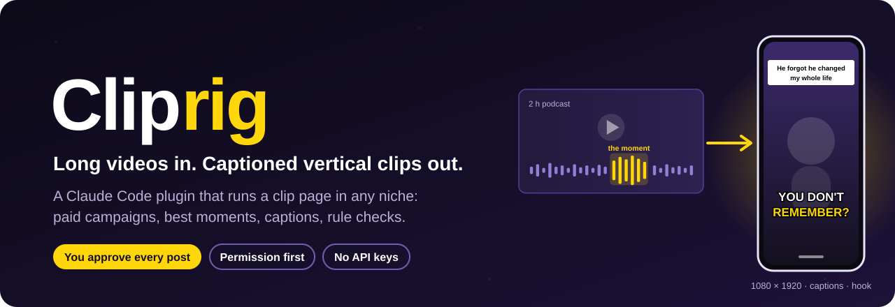
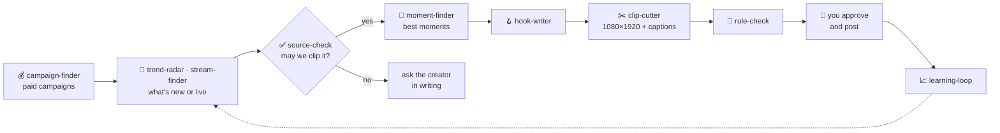

<p align="center">
  
</p>

<p align="center">
  <a href="LICENSE"></a>
  
  
  
  
</p>

<p align="center">
  <b>Turn podcasts, streams and long videos into captioned vertical clips that pay.</b><br>
  Cliprig finds paid clipping campaigns, picks the moments worth clipping, cuts 1080×1920 clips with word-by-word captions,<br>
  checks permission and campaign rules, and learns from your real numbers. You approve every post.
</p>

<p align="center">
  <a href="#quick-start">Quick start</a> ·
  <a href="#how-it-works">How it works</a> ·
  <a href="#skills">Skills</a> ·
  <a href="#rules-it-wont-break">Rules</a> ·
  <a href="#faq">FAQ</a>
</p>

---

## Why Cliprig

Clipping pays per 1,000 views, but most of the job is grunt work: scrubbing two-hour videos, cropping to vertical, typing captions, rereading campaign rules, and tracking what worked. Cliprig hands that work to Claude and keeps the decisions with you.

- 🎯 **Any niche.** Podcasts, stand-up, Twitch streams, sports, education, gaming. Setup tailors the page to yours.
- 🔎 **Finds the moment, not just the loud part.** Laughs and loudness spikes, hook phrases, YouTube's "most replayed" graph and live-chat spikes, cut on sentence edges so clips don't start mid-thought.
- ✂️ **Finished clips, not rough cuts.** 1080×1920, word-by-word captions with the spoken word highlighted, a hook box, -14 LUFS audio, swears masked.
- ✅ **Permission first, every time.** No source gets cut without proof you may clip it, and every segment is checked for music before it's posted.
- 📈 **Learns from real numbers.** Logs every post, reads views at 12, 24 and 72 hours, and tells you what to do more of. It never makes up a number.
- 🔑 **No API keys, no accounts.** Runs on your machine with yt-dlp, ffmpeg and faster-whisper.

## Quick start

In Claude Code:

```
/plugin marketplace add codingwolf-at/cliprig
/plugin install cliprig@cliprig
```

Then say:

> set up my clip page

Setup asks 4 questions (page name, niche, platforms, time zone), installs the tools, and creates a folder for your page. From then on, talk to it like a teammate:

| You say | Cliprig does |
|---|---|
| "which campaigns should I join?" | Reads live campaigns for your niche and ranks them by pay, budget left and views to first payout |
| "what should I clip today?" | Checks which creators you're allowed to clip have new videos or are live now |
| "find the moments in this video" + a link | Downloads, transcribes and ranks the best 15–40 second moments |
| "cut number 3" | Writes hook options, cuts the vertical clip, and runs the rule check |
| "make it in Spanish" | Translates the captions and hook and renders a Spanish version |
| "run the page" | Runs your whole day, from finding sources to the evening report |
| "how did this week go?" | Weekly review: top and bottom posts, what's working by pillar, platform and time |

## How it works



Each step is a skill Claude runs for you. `playbook` chains them into a daily routine, and `live-mode` does the same while a stream is still live.

## Skills

**Find**

| Skill | What it does |
|---|---|
| `campaign-finder` | Live clipping campaigns for your niche (Content Rewards and similar): pay per 1K views, budget left, views to first payout, rules. Ranked for a new or established page |
| `trend-radar` | Recent long videos from creators you may clip, or the whole niche, ranked by views per hour, with a permission column |
| `stream-finder` | Live streams on YouTube and Twitch ranked by viewers, and which of your creators are live right now |
| `questions-to-posts` | Clusters the questions your audience keeps asking, then finds the moment in your sources that answers each one |

**Make**

| Skill | What it does |
|---|---|
| `moment-finder` | Ranks clip candidates in a long video, podcast or VOD from laughs, loudness, hook phrases, "most replayed" and chat spikes |
| `hook-writer` | 3 on-screen hooks per clip in different patterns, checked against the clip and against what worked before |
| `clip-cutter` | Cuts a 1080×1920 clip: fill, blur or facecam layout, word-by-word captions, hook box, loudness normalized |
| `multilang` | The same clip in other languages: Claude translates the captions and hook, rendered in the original layout |
| `live-mode` | Records a live YouTube or Twitch stream with its chat and cuts raw clips around chat spikes while it runs |

**Check**

| Skill | What it does |
|---|---|
| `source-check` | Proof of permission for every source (campaign, written OK or CC BY), and a music check on every segment |
| `rule-check` | Before posting: specs, length, required tags, banned terms and credit, plus a hand check of campaign-only rules |

**Run**

| Skill | What it does |
|---|---|
| `setup` | Installs the tools, asks 4 questions, builds your page folder |
| `playbook` | Your day: the 7-day kickoff, then find, check, cut, approve, log, engage and report |
| `learning-loop` | Logs every post, fills 12/24/72-hour reads, daily and weekly reviews with medians by pillar, platform, format, hour and test |

## Rules it won't break

These are built into the skills, not left to good intentions:

- **You post, it never does.** Every clip waits for your "yes". Nothing is uploaded automatically.
- **Permission first.** Only joined campaigns, campaign-supplied footage, creators who allow clipping in writing, or plain CC BY. The proof is saved with the source. "Fair use" doesn't count.
- **No audible music.** Every segment gets a music check: sound in the gaps between speech, and words only an unfiltered transcription hears (often lyrics).
- **Real numbers only.** No invented rates, budgets, views or earnings, and no earnings promises.
- **Credit every creator,** and never put words in their mouth.
- **No AI voiceover** unless a campaign allows it.
- **One Content Rewards account per person.** Run several pages from one account.

## Your page folder

Setup creates one folder per page. It's plain files you can read, edit and keep in git:

```
my-page/
├── CLAUDE.md          # the page's niche, platforms, time zone and rules
├── playbook.md        # pillars, skip list, posting mix, caption rules
├── campaigns.md       # campaigns found, joined and skipped, with their briefs
├── watchlist.md       # creators you may clip, with proof
├── scoreboard.csv     # every post and its 12/24/72-hour numbers
├── learning.md        # wins, losses and the rules that came out of them
├── payouts.csv        # what campaigns actually show
├── media/raw/<source>/SOURCE.md   # permission proof per source
├── media/edits/       # finished clips
└── jobs/              # downloads, transcripts and candidates (gitignored)
```

## Requirements

- [Claude Code](https://claude.com/claude-code)
- Python 3.10–3.12 (faster-whisper has no wheels for newer versions yet)
- ffmpeg with libass for captions. On macOS: `brew install ffmpeg-full`. Setup installs it for you.

Tested on macOS with Apple Silicon. Linux and Windows should work, and reports are welcome. Transcription runs on your machine: on an M3 it takes about a quarter of the video's length, and an NVIDIA GPU is used when there is one.

## FAQ

**Do I need API keys or paid tools?**
No. Downloads use yt-dlp, transcription runs locally with faster-whisper, and Twitch is read without a key. Campaign platforms are read like any visitor would read them, and joining stays with you.

**Can it clip any video I find?**
No, on purpose. Clips without permission draw claims and strikes, which cost more than they earn. Cliprig only cuts sources with proof that clipping is allowed, and tells you when to ask a creator instead.

**Will it make me money?**
It does the work. It can't promise views or payouts, and it won't pretend to. Pay depends on approved views and each campaign's rules.

**Does it post for me?**
No. It prepares the clip, caption and credit and waits for your "yes". You post, so your accounts stay yours.

## Contributing

Issues and pull requests are welcome. Each skill is a `SKILL.md` in `skills/`, and the scripts it runs are in `scripts/`. Scripts with logic carry a self-test:

```bash
for s in music_check moments cut check review trends translate questions; do python scripts/$s.py --self-test; done
```

## Disclaimer

Cliprig is an independent project. It isn't affiliated with Anthropic, Content Rewards, Whop, YouTube, Twitch or Reddit. You're responsible for following the terms of the platforms you use and the rules of each campaign you join.

## License

[MIT](LICENSE) © Atul Tameshwari
